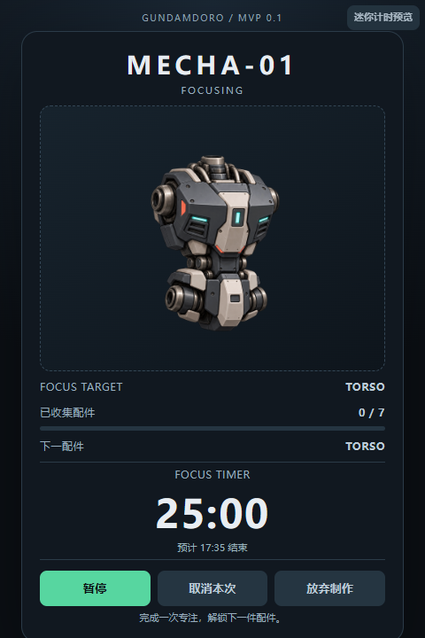
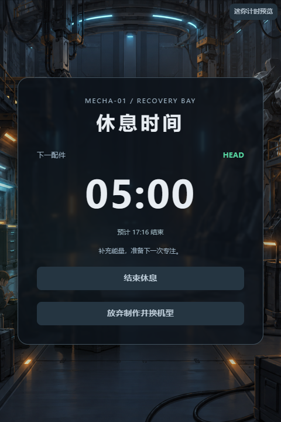
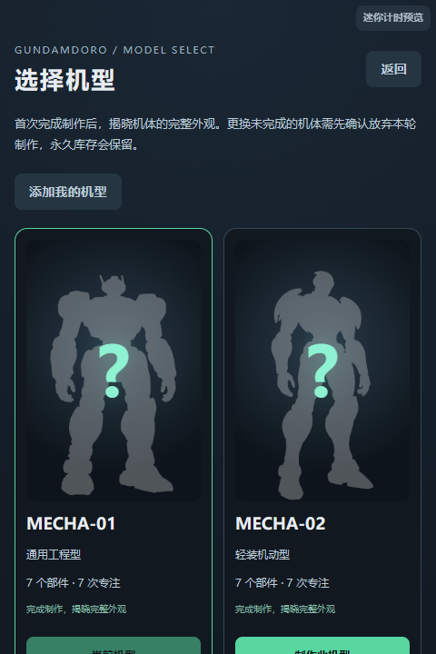
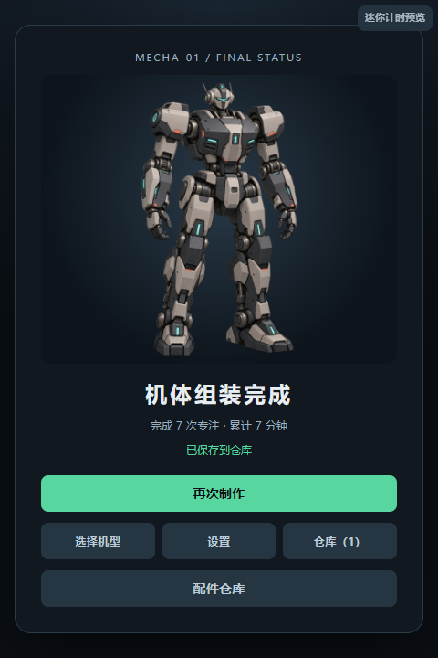
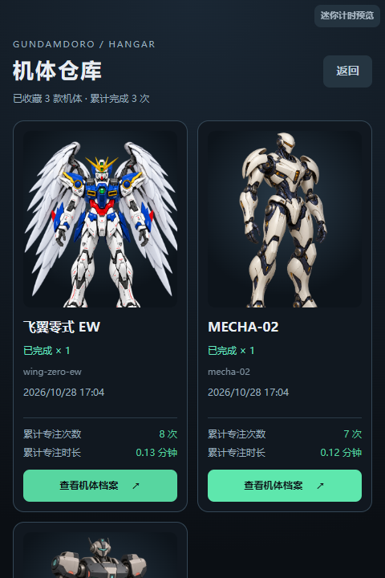
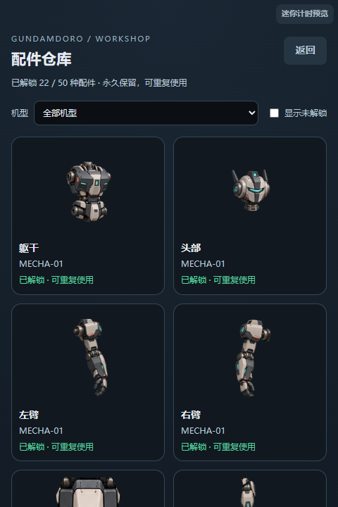
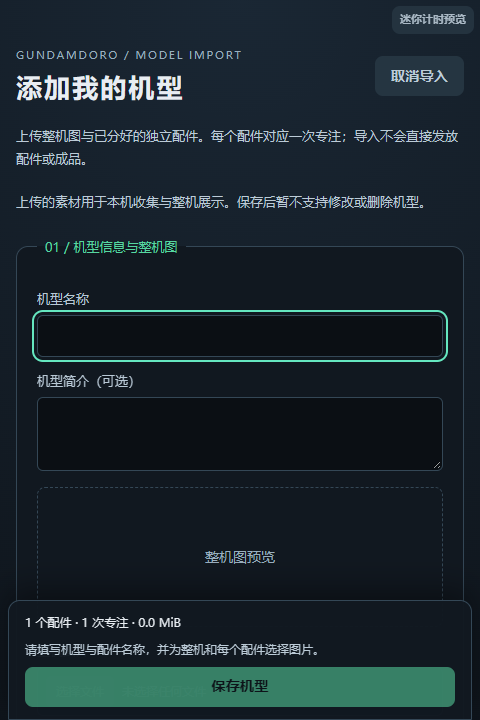
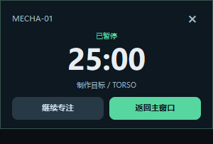
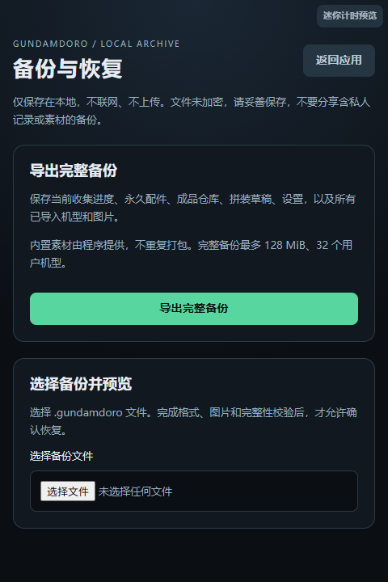

# Gundamdoro

**把专注时间变成可收集的机甲配件。**

Gundamdoro 是一款结合机甲收集的 Windows 桌面番茄钟。每完成一次专注，就获得一个机甲配件；集齐后亲手点击拼装，让一段段专注时间变成仓库里的成品。

应用支持离线使用和网页运行，无需注册账号，进度与导入素材均保存在本地。

[功能预览](#功能预览) · [安装与使用](#安装与使用) · [本地开发](#本地开发) · [构建与部署](#构建与部署) · [项目结构](#项目结构) · [许可证](#许可证与素材说明)

## 功能预览

以下为应用实际界面，截图中的库存与统计使用演示数据。

### 专注计时

默认专注 25 分钟，支持 15 / 25 / 45 分钟快捷选择，也可在设置中调整为 1–120 分钟。专注界面展示本次目标配件、倒计时和预计结束时间，支持暂停、继续和取消。

“取消本次”保留本轮已获配件；“放弃制作”经过确认后清空本轮进度，永久配件、历史成品和设置保留。



### 休息场景

尚未集齐配件时，完成专注后进入工厂生活场景休息。默认休息 5 分钟，可设置为 1–60 分钟，也可提前结束；下一次专注始终由你主动开始。



### 多机型选择

内置六款原创生成机型及一款用户提供的“飞翼零式 EW”非官方生成同人机型。未完成机型先显示轮廓和问号，完成固定机体并入库后揭示完整外观。



每款机型所需的专注次数由配件数量决定：六款原创机型各需 7 次，飞翼零式 EW 包含独立翅膀，需要 8 次。

### 配件收集与手动拼装

每完成一次专注获得一个独立配件，集齐后点击“开始拼装”，观看最终整机展示。最终拼装无需额外专注，也不会额外计入专注统计。



### 机体仓库与详情

制作完成的机体自动归档。同一固定机型在列表中只显示一张卡片，累计完成次数与历史统计保留；点击卡片可查看机体档案、背景故事及制作记录。



### 永久配件仓库

已解锁配件永久保留，可按机型筛选并查看未解锁项。重复制作不会叠加同一种配件的数量，放弃本轮制作也不会清空库存。



### 导入自己的机型

在“选择机型 → 添加我的机型”填写名称、可选简介，上传整机图和 1–32 张独立配件图。支持调整配件顺序或移除尚未保存的配件；顺序决定收集顺序，每件对应一次专注。

支持 PNG / JPEG / WebP，单图不超过 8 MiB、1600 万像素，整套不超过 64 MiB。目前不支持保存后修改或删除机型。



### 桌面迷你计时器与完成提醒

开启迷你计时器后，最小化主窗口会显示可拖动、置顶的小窗口，支持暂停、继续和返回主窗口。关闭主窗口会退出应用；网页仅提供页面内的迷你预览。

支持可选提示音和系统通知。通知默认关闭，开启需授予权限，实际展示受 Windows 通知设置与勿扰模式影响。



### 本地备份与恢复

在待机或制作完成页打开“设置 → 备份与恢复”，导出包含进度、永久配件、仓库、设置、用户机型及图片的完整文件。恢复前展示摘要并要求确认，恢复会覆盖当前进度，不合并统计。



备份文件最多 128 MiB，支持最多 32 个用户机型，文件未加密。更新、清理数据或迁移设备前，建议先导出备份。

## 安装与使用

### Windows 安装版

在 [Releases](https://github.com/ivan329992-hash/Gundamdoro/releases) 查看可用版本。如有 Windows x64 的 `.msi` 安装包，下载并安装后即可启动；尚未提供安装包时，可按下文从源码构建。

支持 Windows x64，需要 Microsoft Edge WebView2 Runtime。运行安装版不需要安装 Node.js 或 Rust；macOS 与 Linux 暂未提供经过验证的发行版。

### 第一次使用

1. 选择机型，在设置中确认专注和休息时长。
2. 点击“开始专注”，每完成一次获得一个独立部件。
3. 休息结束后主动开始下一次专注，直到部件集齐。
4. 点击“开始拼装”，再到机体仓库查看成品；已有配件可在配件仓库浏览。

## 本地开发

### 环境要求

网页开发需要 Node.js 24.x（或 22.13+ 的 22.x 版本）及 npm。

Windows 桌面开发还需要 Rust stable MSVC 工具链、Visual Studio Build Tools 的“使用 C++ 的桌面开发”组件、Windows SDK 和 WebView2 Runtime。

### 启动网页

```powershell
git clone https://github.com/ivan329992-hash/Gundamdoro.git
cd Gundamdoro
npm ci
npm run dev
```

打开 [http://localhost:1420/](http://localhost:1420/)。前端修改支持热更新，无需重新安装桌面程序。

网页可以体验计时、收集、仓库和机型导入；桌面置顶迷你窗口需要使用 Tauri 运行。

### 启动 Windows 桌面应用

```powershell
npx tauri dev
```

在完成 `npm ci` 后运行以上命令。Tauri 会自动启动前端开发服务，请先停止独立运行的 `npm run dev`，避免端口冲突。

### 运行检查

| 命令 | 用途 |
| --- | --- |
| `npm run lint` | 静态代码检查 |
| `npm run format:check` | 格式检查 |
| `npm test` | 单元与组件测试 |
| `npx tsc -b` | TypeScript 类型检查 |
| `npm run test:e2e` | Playwright 浏览器端到端测试 |

首次运行端到端测试前，安装 Chromium：

```powershell
npx playwright install chromium
```

## 构建与部署

### Windows 安装包

```powershell
npx tauri build --bundles msi
```

该命令自动构建前端和 Rust 桌面程序，MSI 安装包输出到 `src-tauri/target/release/bundle/msi/`。

### 网页静态部署

```powershell
npm run build
npm run preview -- --host 127.0.0.1 --port 4173
```

构建结果位于 `dist/`，可在 [http://127.0.0.1:4173/](http://127.0.0.1:4173/) 本地预览。正式部署时，将该目录内容发布到静态托管服务，无需后端或数据库；`npm run preview` 仅用于本地预览。

默认部署于站点根路径，子目录部署需修改 `vite.config.ts` 中的 `base` 后重新构建。正式站点应使用 HTTPS，并支持 OPFS 和 Web Crypto，以使用机型导入及备份恢复。

## 项目结构

前端采用 React 19、TypeScript、Vite 和 Zustand，动画使用 Framer Motion；桌面集成由 Tauri 2 与 Rust 提供，测试使用 Vitest 和 Playwright。

```text
Gundamdoro/
├─ src/
│  ├─ app/               # 根界面与依赖装配
│  ├─ components/        # 页面与交互组件
│  ├─ hooks/             # 计时刷新、阶段调度与窗口协作
│  ├─ store/             # Zustand 状态管理与操作入口
│  ├─ application/       # 业务用例、接口定义与存档迁移
│  ├─ domain/            # 计时、收集、仓库等业务规则
│  ├─ adapters/          # 存储、素材与桌面能力的具体实现
│  ├─ mecha/             # 机型清单、展示配置与背景档案
│  ├─ assets/mecha/      # 内置机型图片
│  └─ styles/            # 全局与各界面样式
├─ src-tauri/            # Rust 桌面程序、权限与打包配置
├─ tests/                # 架构、素材及端到端测试
├─ public/               # 网站图标等静态资源
└─ SPEC.md               # 产品需求与行为约定
```

业务调用方向为 `界面 / hooks → store → application → domain`。存储、时钟与桌面能力通过接口注入，具体实现在 `adapters/`，由 `app/dependencies.ts` 统一装配。

阅读代码可从 [App.tsx](src/app/App.tsx) 开始，查看各阶段对应的页面，再沿 store 操作进入业务用例。新增或修改行为时，参考 [SPEC.md](SPEC.md) 中的约定。

## 数据保存

进度和设置使用 localStorage 保存；导入的机型图片在网页端使用浏览器 OPFS，在桌面端保存在应用本地数据目录。当前没有账号、云同步或自动更新。

网页存档按浏览器和站点来源隔离，切换域名或端口不会自动带入原有进度；网页与桌面应用之间也不共享存档。迁移时使用“设置 → 备份与恢复”，清理浏览器数据前请先备份。

## 反馈与贡献

欢迎通过 [Issues](https://github.com/ivan329992-hash/Gundamdoro/issues) 反馈问题或提出建议。报告故障时请提供运行版本、操作系统、网页或桌面环境、复现步骤和截图。

提交代码前，请运行静态检查、格式检查及相关测试；涉及交互流程的修改，请同时验证端到端测试。新增机型素材需注明来源和使用许可。

## 许可证与素材说明

Copyright 2026 [ivan329992-hash](https://github.com/ivan329992-hash)。代码采用 [Apache License 2.0](LICENSE)。再发布本项目或衍生版本时，须按许可证要求保留适用的版权、许可声明及 [NOTICE](NOTICE) 中的署名信息。

仓库包含六套原创生成机型，以及一套“飞翼零式 EW”非官方生成同人素材；代码许可证不授予相关角色、名称或形象的商业使用权。

素材来源见 [飞翼零式素材说明](src/assets/mecha/wing-zero-ew/ASSETS.md) 和 [拼装素材来源](src/assets/mecha/ASSEMBLY_SOURCES.md)。机体详情中的能力指数与背景故事为应用内设定，不代表官方资料。
